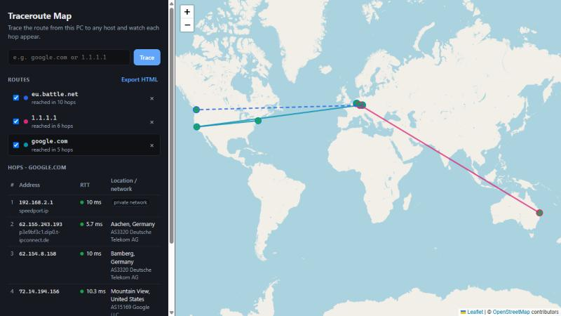

# Traceroute Map

Run a traceroute from your own PC and watch every hop show up live on a world map, with latency, hostname, network (AS) and approximate location for each hop.



## Features

- Type a hostname or IP address and the hops appear on the map one by one while the trace is running
- For each hop: IP address, reverse DNS name, three round-trip times, AS number and provider, city and country
- Markers are colored by latency: green under 30 ms, amber from 30 to 99 ms, red from 100 ms
- Compare several targets on one map, with one colored route per target that you can show, hide or remove
- Hops that don't reply (`* * *`) and private addresses (your router, carrier-grade NAT) appear in the table but not on the map. A dashed line means some hops in between had no location
- Export the visible routes as a single HTML file you can open anywhere

## Install

Requires Python 3.11 or newer.

```bash
git clone https://github.com/Slide789/traceroute-map.git
cd traceroute-map
python -m venv .venv
.venv\Scripts\activate        # Windows
# source .venv/bin/activate   # Linux / macOS
pip install .
```

## Usage

```bash
traceroute-map
```

This starts a small local server on `http://127.0.0.1:8765` and opens it in your browser. Press Ctrl+C in the terminal to stop it.

## How it works

```
tracert / traceroute  →  parser  →  reverse DNS + GeoIP  →  Server-Sent Events  →  Leaflet map
```

1. The tool runs your operating system's traceroute (`tracert -4 -d` on Windows, `traceroute -n` on Linux/macOS) and reads its output line by line.
2. The parser only looks at numbers, `*` and IP addresses, never at words, so it works whatever language your system uses.
3. Each public hop is looked up at ip-api.com for its approximate location and AS. Results are cached while the tool is running.
4. Hops are streamed to the browser as Server-Sent Events and drawn with Leaflet on OpenStreetMap tiles.

Everything runs on your machine. The trace always starts from the PC that runs the tool.

## Limitations

- **Locations are approximate.** GeoIP databases often return the place where a network is registered, not where the router actually is. Anycast addresses such as `1.1.1.1` can show up on the other side of the world even though they answer in 10 ms.
- **`* * *` is normal.** Many routers don't answer traceroute probes, so some hops will always be missing.
- **IPv4 only** for now.
- **Linux/macOS** need the `traceroute` package installed. The tool was developed and tested on Windows 11.

## Data sources and credits

- Geolocation and AS data: [ip-api.com](https://ip-api.com). The free tier is for non-commercial use only and allows 45 requests per minute. The tool stays under that limit on its own.
- Map tiles: © [OpenStreetMap](https://www.openstreetmap.org/copyright) contributors
- Map library: [Leaflet](https://leafletjs.com)

## Development

```bash
pip install -e ".[dev]"
pytest
```

## License

[MIT](LICENSE)
