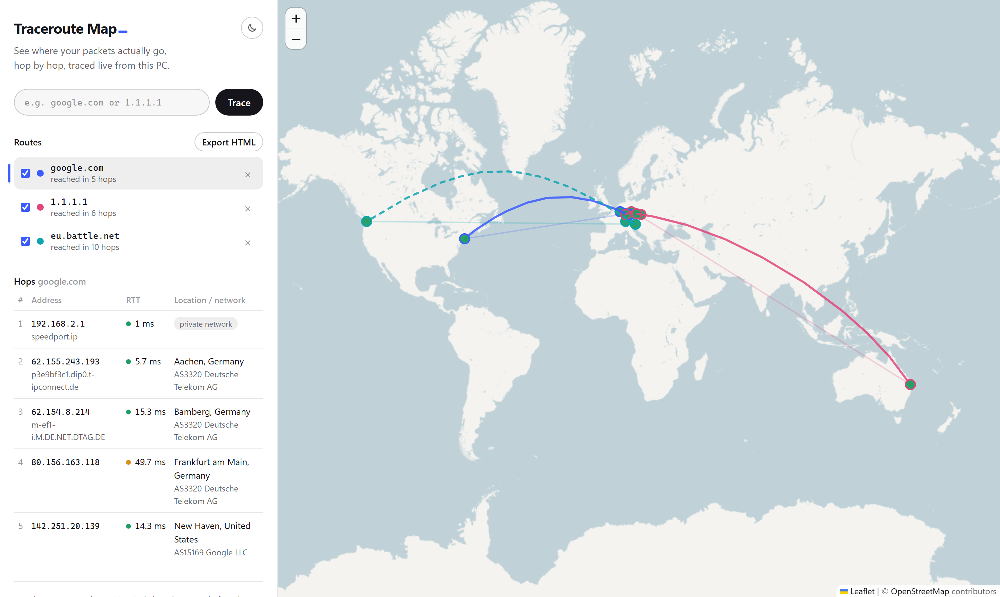

# Traceroute Map

Traceroute Map runs a traceroute from your own PC and draws each hop on a world map as soon as it answers. For every hop you see the latency, hostname, network (AS) and a rough location.

<picture>
  <source media="(prefers-color-scheme: dark)" srcset="docs/screenshot-dark.png">
  
</picture>

## Features

- Enter a hostname or IP address and watch the hops appear one by one while the trace runs.
- Each new hop flies in from the previous one along a curved arc with a shadow underneath, so you can follow the route as it builds.
- The table lists every hop with its IP address, reverse DNS name, three round-trip times, AS number, provider, city and country.
- Markers are colored by latency: green under 30 ms, amber from 30 to 99 ms, red from 100 ms.
- You can trace several targets onto the same map. Each one gets its own color and can be shown, hidden or removed.
- Hops that don't reply (`* * *`) and private addresses such as your router or carrier-grade NAT are listed in the table but left off the map. When hops are missing between two points, the line between them is dashed.
- There's a light and a dark theme. It starts with your system setting, and the button next to the title switches it.
- Export the visible routes as one HTML file that opens in any browser.

## Install

You need Python 3.11 or newer.

```bash
git clone https://github.com/Slide789/traceroute-map.git
cd traceroute-map
python -m venv .venv
.venv\Scripts\activate        # Windows
# source .venv/bin/activate   # Linux / macOS
pip install .
```

## Usage

```bash
traceroute-map
```

This starts a small local server on `http://127.0.0.1:8765` and opens it in your browser. Press Ctrl+C in the terminal to stop it.

## How it works

```
tracert / traceroute  →  parser  →  reverse DNS + GeoIP  →  Server-Sent Events  →  Leaflet map
```

1. The tool runs your system's traceroute (`tracert -4 -d` on Windows, `traceroute -n` on Linux/macOS) and reads the output line by line.
2. The parser only reads numbers, `*` and IP addresses and ignores words, so it works in any system language.
3. Each public hop is looked up at ip-api.com for its approximate location and AS. Lookups are cached for as long as the tool runs.
4. The server streams the hops to the browser as Server-Sent Events, and Leaflet draws them on OpenStreetMap tiles.

Everything runs locally, and the trace always starts from the PC running the tool.

## Limitations

- Locations are approximate. GeoIP databases often return the place where a network is registered, which can be far from the actual router. Anycast addresses such as `1.1.1.1` may show up on the other side of the world even though they answer in 10 ms.
- `* * *` is normal. Many routers ignore traceroute probes, so some hops will always be missing.
- Only IPv4 is supported for now.
- On Linux and macOS you need the `traceroute` package. I built and tested the tool on Windows 11.

## Data sources and credits

- Geolocation and AS data come from [ip-api.com](https://ip-api.com). The free tier is for non-commercial use and allows 45 requests per minute, and the tool keeps itself under that limit.
- Map tiles: © [OpenStreetMap](https://www.openstreetmap.org/copyright) contributors
- Map library: [Leaflet](https://leafletjs.com)

## Development

```bash
pip install -e ".[dev]"
pytest
```

## License

[MIT](LICENSE)
